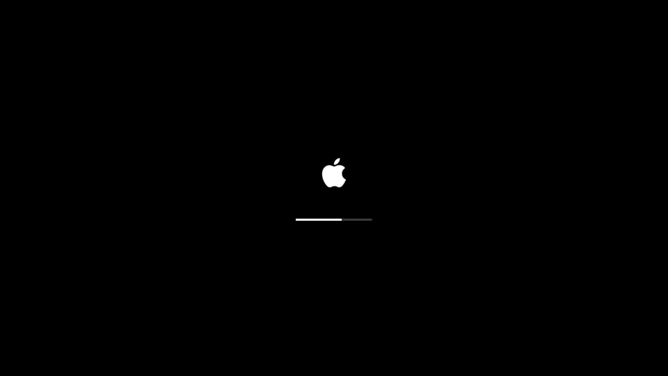

# Tahoe

> **Créditos:** a base visual vem dos temas **MacTahoe**, de **vinceliuice**, fixados como submodules em `vendor/`:
> [MacTahoe-kde](https://github.com/vinceliuice/MacTahoe-kde) (LGPL), [MacTahoe-icon-theme](https://github.com/vinceliuice/MacTahoe-icon-theme) (GPL-3.0) e [MacTahoe-gtk-theme](https://github.com/vinceliuice/MacTahoe-gtk-theme) (MIT).
> **Páginas web (Stylus):** estilos do **[Catppuccin Userstyles](https://github.com/catppuccin/userstyles)** (MIT, `targets/stylus/LICENSE-catppuccin-userstyles`), fixados em `vendor/catppuccin-userstyles`; só a paleta e o header mudam.
> Fontes SF Pro / SF Mono são da Apple: baixadas do site da Apple na instalação, nunca guardadas aqui.

Tema macOS Tahoe (modo escuro) para **Arch Linux / CachyOS com KDE Plasma 6**. Sem modo claro.

Projeto pessoal de tema para Arch Linux, criado com a ajuda do [Claude Code](https://claude.com/claude-code): paleta, scripts de instalação, alvos de cada app e testes foram escritos em conjunto com o Claude, testados numa máquina CachyOS real.

> **Avisos**
> - Só testado em Plasma 6 (KWin 6.7). Plasma 5 e GNOME não são suportados.
> - O blur usa o `kwin-effects-better-blur-dx`, do AUR. Ele pode quebrar quando o KWin atualiza; se o blur sumir depois de um update, reinstale o pacote (`paru -S --rebuild kwin-effects-better-blur-dx`).
> - Os efeitos do cursor (`effects/tahoecursor`) também quebram quando o KWin atualiza: o KWin só carrega plugin compilado para a versão exata dele. Para recompilar, na raiz do repo: `rm -rf build/_cmake-tahoecursor && cmake -S effects/tahoecursor -B build/_cmake-tahoecursor -DCMAKE_BUILD_TYPE=Release -DCMAKE_INSTALL_PREFIX=/usr && cmake --build build/_cmake-tahoecursor && sudo cmake --install build/_cmake-tahoecursor`, depois logout/login. Se a compilação falhar, a API do KWin mudou e o código do plugin precisa ser adaptado (foi o caso na 6.8). Para ver se é isso: `journalctl --user -b | grep "different version of KWin"`.
> - Pacotes do AUR precisam de `paru` ou `yay` instalado.
> - A maçã (boot e barra) e as fontes SF são marcas e arquivos da Apple. As fontes são baixadas do site da Apple na instalação e seguem a licença dela.

## Instalação (em qualquer máquina Arch/CachyOS + Plasma 6)

```sh
git clone --recursive https://github.com/gilas-byte/tahoe-theme.git tahoe-theme && cd tahoe-theme
# já clonou sem --recursive? git submodule update --init
./install.sh --dry-run       # mostra o que faria, sem alterar nada
./install.sh                 # instala dependências que faltarem (com confirmação) e aplica tudo
```

Depois, três passos à mão (o sistema não deixa automatizar):

1. **Boot e tela de login** (precisam de root), na raiz do repo:
   ```sh
   sudo targets/plymouth/apply.sh tahoe tahoe          # boot com a maçã (refaz o initramfs)
   sudo targets/login/apply.sh install tahoe Tahoe     # fonte e Plasma Style para a tela de login
   ```
   E em Configurações do Sistema → Tela de login: wallpaper MacTahoe-Dark + "Aplicar configurações do Plasma".
2. **Brave:** brave://extensions → "Carregar sem compactação" → Ctrl+L → `~/.local/share/tahoe/brave-theme`.
3. **Stylus:** Gerenciar → Importar → `~/.local/share/tahoe/stylus/import.json` (apague estilos de outros temas antes).

Faça logout/login uma vez no fim.



## Perfis de vidro

```sh
./install.sh --profile vidro-sutil   # menus quase opacos, sidebars opacas, blur leve
./install.sh --profile vidro-tahoe   # o máximo que ainda passa no teste de contraste
./install.sh --profile padrao        # volta ao vidro médio do palette.toml
```

O perfil fica gravado: os próximos `./install.sh` usam o mesmo. Perfis são arquivos em
`profiles/` que sobrescrevem só as chaves que definem.

## Outros comandos

```sh
./install.sh --only alvo     # só um alvo (ou vários: --only a,b)
./install.sh --list          # lista os alvos, se foram detectados e dependências faltando
./uninstall.sh               # restaura arquivos e chaves do KDE ao estado anterior
./uninstall.sh --dry-run     # mostra o que restauraria
python3 -m tooling check     # só a checagem de contraste WCAG (inclui texto sobre vidro)
python3 -m tooling render    # só renderiza templates em build/
tests/selftest.sh            # prova render, dry-run, idempotência, backup e restore em /tmp
tests/stylus-check.py        # alvo stylus: lib, filtros, import.json, contraste (+ compila com less se houver)
```

## Voltar ao tema anterior

```sh
./uninstall.sh                                   # tudo que é do usuário, ao estado de antes
sudo targets/plymouth/apply.sh <tema-antigo> tahoe   # boot (ex.: cachyos, bgrt, spinner)
sudo targets/login/apply.sh remove tahoe         # e "Redefinir" na página Tela de login
```


## Garantias

- **Idempotente:** rodar `./install.sh` duas vezes seguidas não muda nada na segunda.
- **Dry-run de verdade:** `--dry-run` renderiza numa pasta temporária; nada que o sistema lê muda.
- **Backup antes de tocar:** arquivos e chaves do KDE vão para `~/.local/state/tahoe/backups/<timestamp>/manifest.json`. O `uninstall` volta ao estado de antes do tema.
- **Estado separado:** tudo que o tema guarda fica em `~/.local/state/tahoe`.
- **Sem sudo para o tema:** tudo vai para `~`. Exceções, sempre rodadas à mão:
  - `sudo targets/plymouth/apply.sh tahoe tahoe` (boot; volta com `sudo targets/plymouth/apply.sh <tema-antigo> tahoe`)
  - `sudo targets/login/apply.sh install tahoe Tahoe` (fonte e Plasma Style para a tela de login; desfaz com `remove tahoe`)
- Arquivos que o KDE reescreve (`kdeglobals`, `kwinrc`…) são alterados chave a chave, com `kwriteconfig6`.

## Alvos

Cada alvo é uma pasta em `targets/` com um `target.toml` e `templates/`. Formato: ver `ARCHITECTURE.md`.

| Alvo | O que faz |
|---|---|
| `_selftest` | Só para teste, roda em `/tmp` (só com `--only`). |
| `fonts` | SF Pro Text na interface e SF Mono na monoespaçada, baixadas da Apple para `~/.local/share/fonts/tahoe-apple`. |
| `kde-colors` | `Tahoe.colors` com as cores do macOS escuro. |
| `decoration` | Klassy, botões na posição padrão do KDE. |
| `klassy-glass` | Barra de título de vidro só nas janelas de `[glass_windows]` (Ghostty): preset "Tahoe Vidro" + exceção do Klassy. |
| `icons` | MacTahoe-dark (instalado de `vendor/` se faltar). |
| `kvantum` | Kvantum `Tahoe`: MacTahoeDark recolorido pela paleta, com sidebar e menus de vidro. |
| `cursor` | apple_cursor `macOS` (download com sha256 conferido), tamanho 28. |
| `blur` | better-blur-dx com o vidro da paleta; painéis translúcidos. |
| `plasma-style` | Plasma Style `Tahoe`: MacTahoe-Dark com a opacidade do vidro vinda da paleta. |
| `wallpaper` | MacTahoe-Dark. |
| `layout` | Tira o "mostrar área de trabalho" da barra; cria barra e Dock em máquina nova. Cópia do layout anterior para o uninstall. |
| `animations` | Minimizar com Magic Lamp no lugar do Squash. |
| `cursor-effects` | Plugin próprio do KWin (`effects/tahoecursor`): pontas do cursor dobram com o "vento" do movimento (ou esticam, com `Motion=stretch`) e ele encolhe no clique, tela afunda e ondula onde você clica. Compila e instala com sudo; depois, logout/login. |
| `dolphin` | Abre em ícones; sidebar sem Remote e Recent. |
| `ghostty` | Tema `tahoe`, SF Mono e respiro nas bordas (bloco no fim do `config.ghostty`). |
| `flatpak` | Overrides globais: tema GTK, ícones e cursor nos apps Flatpak. |
| `brave` | Extensão de tema em `~/.local/share/tahoe/brave-theme` (carregar à mão). |
| `stylus` | 134 userstyles do Catppuccin com as cores da paleta + "Vidro Tahoe" (blur nas barras fixas de alguns sites). |
| `splash` | Splash do MacTahoe-Dark. |
| `lockscreen` | Wallpaper MacTahoe-Dark na tela de bloqueio. |
| `plymouth` | Boot com maçã e barra fina (`sudo targets/plymouth/apply.sh tahoe tahoe`). |
| `switcher` | Alt+Tab com o visual Ícones grandes (cara de Cmd+Tab); atalho igual. |
| `quicklook` | Quick Look: Kiview (Flathub do usuário) no menu do botão direito do Dolphin. |
| `menubar` | Nome do app ativo em negrito na barra (widget do AUR); Central de Controle opcional (`[menubar] control_center`). |
| `glass` | Config do efeito Glass (luz na borda); o motor de blur ligado é escolhido em `[effects]`. |
| `gtk` | MacTahoe-Dark no GTK3 e na libadwaita; assume os dois `gtk.css`. |

## Licença

GPL-3.0 (`LICENSE`).
